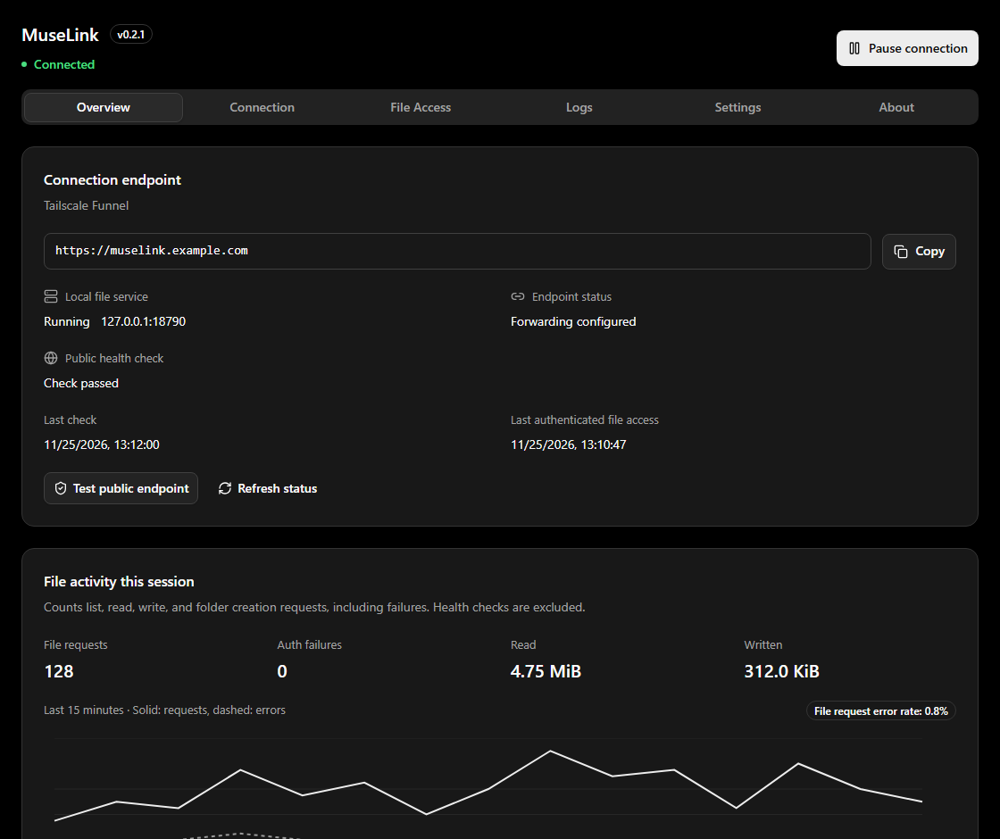
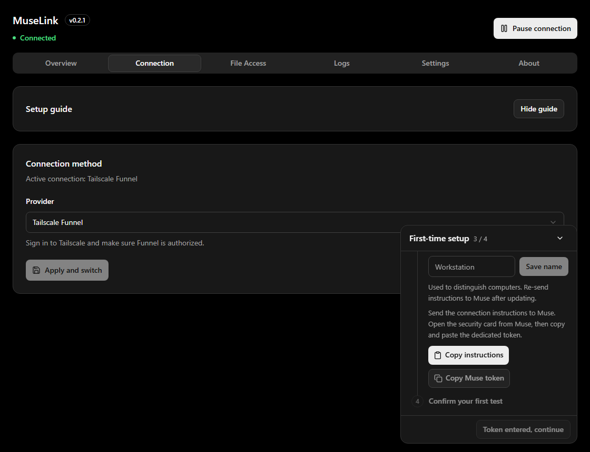
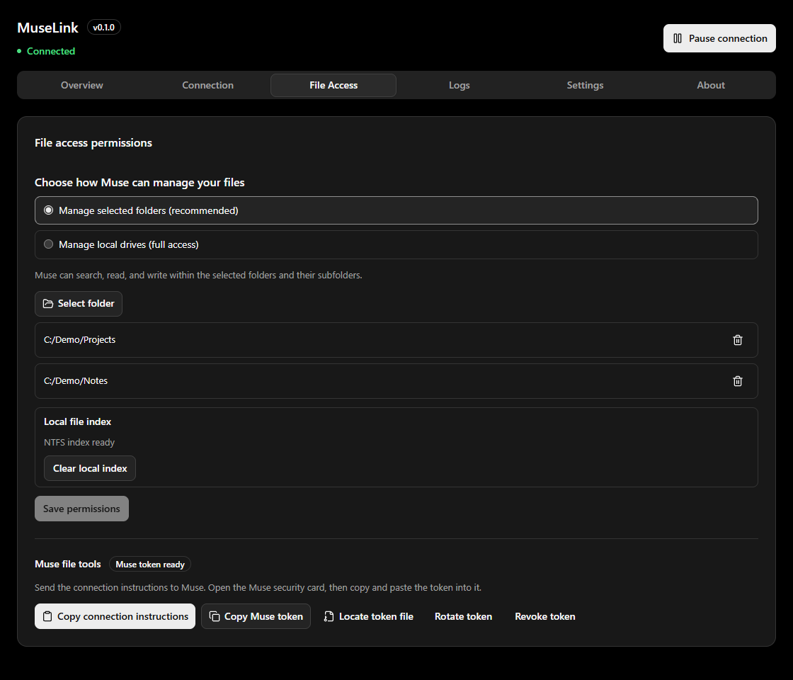

<p align="center">
  
</p>

<h1 align="center">MuseLink — Windows File Connector for Muse</h1>

<p align="center">
  Let Muse search, read, and write files in the Windows folders and drives you authorize.
</p>

<p align="center">
  <a href="README.md">简体中文</a> · <a href="README.en.md">English</a> ·
  <a href="https://github.com/Aenvo/MuseLink/releases/latest">Download latest</a> ·
  <a href="#quick-start">Quick start</a> · <a href="#build-from-source">Build from source</a>
</p>

<p align="center">
  
  
</p>



## App preview

The setup guide in the lower-right corner walks you through granting file access, preparing a public connection, connecting Muse, and testing it for the first time. Return to **File Access** to change folders or drives, manage the index, or manage the Muse token.

<table>
  <tr>
    <td width="50%" align="center">
      <a href="assets/readme/en/setup-guide.png"></a><br>
      <sub>First-time setup · Preparing the public connection</sub>
    </td>
    <td width="50%" align="center">
      <a href="assets/readme/en/file-access.png"></a><br>
      <sub>File Access · Managing permissions and the token</sub>
    </td>
  </tr>
</table>

These screenshots show the MuseLink interface with sample folders, a demo address, and sample file activity.

## Features

| Feature | What it does |
| --- | --- |
| File permissions | Authorize selected folders and their subfolders, or choose from local fixed drives. |
| Local file tools | Let Muse search by file name, list folders, read files, and write when needed. |
| Public connection | Use Tailscale Funnel by default, or choose a Cloudflare quick or named tunnel. |
| Dedicated token | Generate, copy, rotate, or revoke the Muse token in **File Access**. |
| Desktop controls | Check connection status and access logs, pause or start the connection from the app or tray, and switch between English and Simplified Chinese. |

## Download and install

Choose a Windows x64 build from [GitHub Releases](https://github.com/Aenvo/MuseLink/releases/latest). Both builds require WebView2.

| Build | Download and launch |
| --- | --- |
| Portable | Download `MuseLink-<version>-windows-x64-portable.zip`, extract the entire archive, and run `muse-connector.exe`. |
| Installer | Download `MuseLink-<version>-windows-x64-setup.exe` and run the installer. |

Use `SHA256SUMS.txt` from the same release to verify your download. The MuseLink executable and installer are unsigned, so Windows may show an unknown publisher prompt.

## Quick start

For the default connection method, install [Tailscale for Windows](https://tailscale.com/download/windows) and sign in.

1. On **Overview**, select **Start setup**.
2. Choose the folders or drives to authorize. All available local fixed drives are selected by default in drive mode. Open the menu to narrow the selection.
3. Generate a Muse token. Follow the guide to authorize Funnel, start the connection, and verify the public endpoint.
4. Send the generated connection instructions to Muse, then paste the token into the security card that Muse sends back.
5. Choose a non-sensitive file within the authorized scope and check the contents Muse returns.

File indexing starts in the background after you first save permissions. Check its status or rebuild the index in **File Access**. Change the interface language in **Settings → Display language**. MuseLink remembers your choice.

## Access and connection boundaries

- Muse's file operations follow the saved access scope and the current Windows account's permissions. The chosen tunnel forwards the public endpoint to the local file service.
- Enter the dedicated token in the Muse security card. To stop access, pause the connection or revoke the token. Update the security card after rotating it.
- The public health check verifies the endpoint. Have Muse read a non-sensitive file to confirm that the integration works.
- Cloudflare named tunnels require an available domain in your account. Update the connection in Muse if switching providers changes the public URL.

## Build from source

You'll need Windows, WebView2, Node.js 22.12 or later, pnpm, the Rust MSVC toolchain, and Visual Studio C++ Build Tools. Run these commands from the repository root to start development.

```powershell
pnpm -C muse-connector install --frozen-lockfile
pnpm -C muse-connector tauri dev
```

Development mode uses separate local settings and a simulated connection. The following commands build the frontend, run the tests, and make an NSIS installer.

```powershell
pnpm -C muse-connector build
cargo test --manifest-path muse-connector/src-tauri/Cargo.toml --locked
pnpm -C muse-connector tauri build --bundles nsis
```

The installer is written to `muse-connector/src-tauri/target/release/bundle/nsis/`. Run `pnpm -C muse-connector tauri build --no-bundle` to produce just `muse-connector/src-tauri/target/release/muse-connector.exe`.

## Acknowledgments

The legacy file API is based on the [muse-file-bridge](https://github.com/TTNAN/muse-file-bridge) v0.3 protocol. See [THIRD_PARTY_NOTICES.md](./THIRD_PARTY_NOTICES.md) for the upstream MIT license notice.
