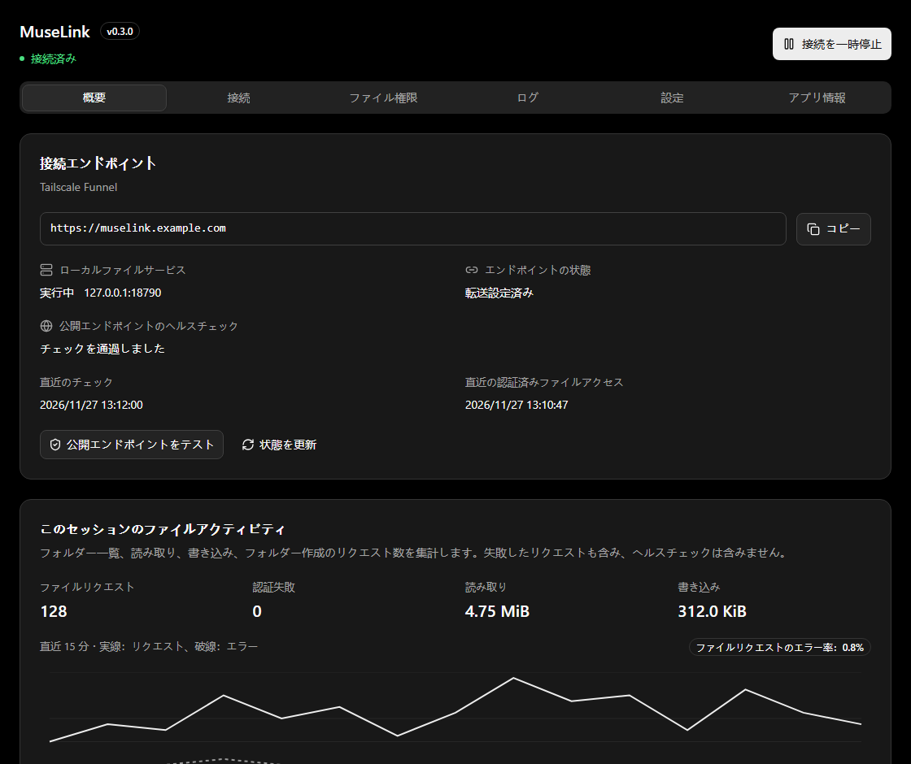
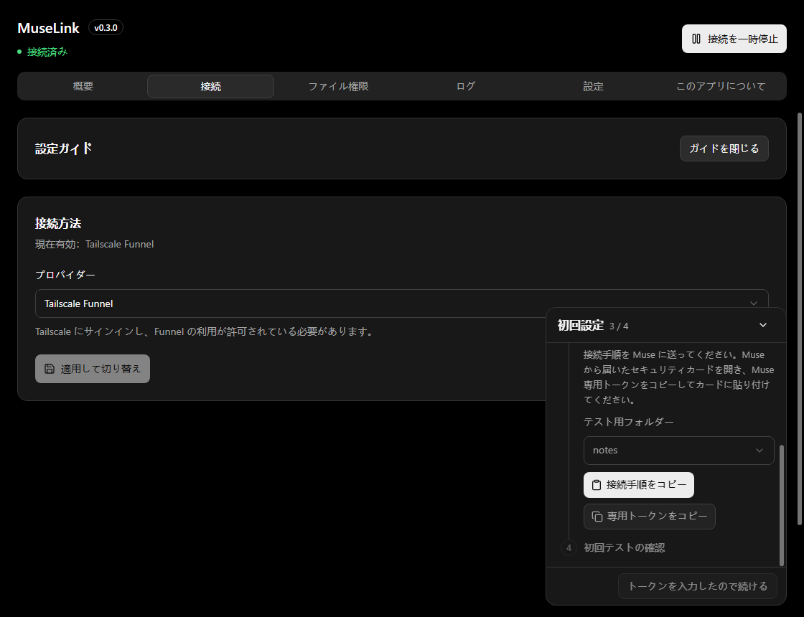
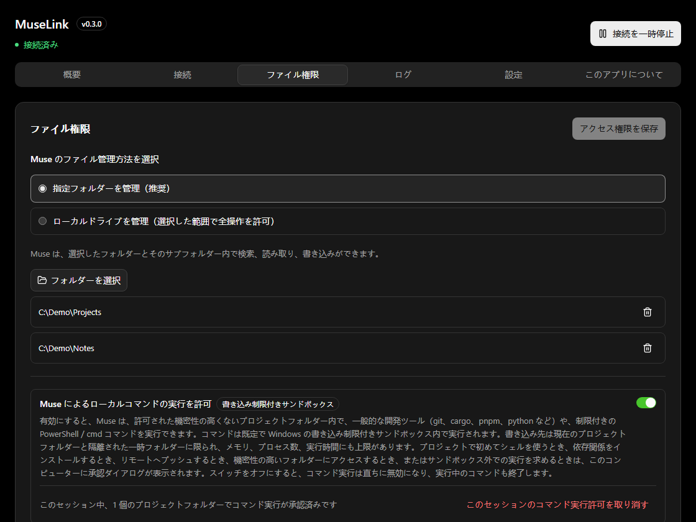
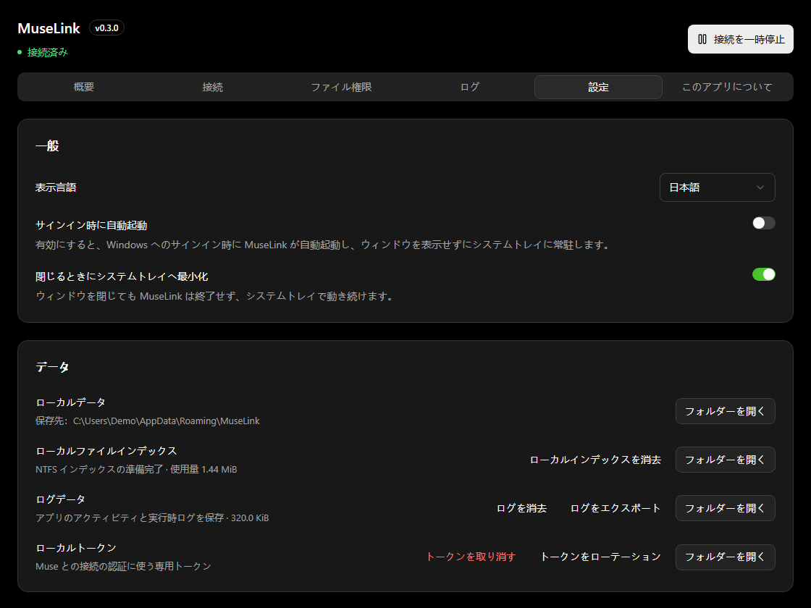

<p align="center">
  
</p>

<h1 align="center">MuseLink — Muse ローカルファイルコネクタ</h1>

<p align="center">
  Windows・Linux・macOS で許可したローカルファイルの検索・読み取り・書き込みを Muse に任せ、Windows では必要に応じて書き込み制限付きサンドボックスとローカル承認ダイアログのもとでプロジェクトコマンドも実行できます。
</p>

<p align="center">
  <a href="README.md">简体中文</a> · <a href="README.en.md">English</a> · <a href="README.ja.md">日本語</a> ·
  <a href="https://github.com/Aenvo/MuseLink/releases/latest">最新版をダウンロード</a> ·
  <a href="#クイックスタート">クイックスタート</a> · <a href="#ソースからビルド">ソースからビルド</a> ·
  <a href="CHANGELOG.en.md">変更履歴</a>
</p>

<p align="center">
  
  
  
  
  <a href="./LICENSE"></a>
</p>



## 画面プレビュー

右下の設定ガイドに沿って、ファイルアクセス権限の設定、公開接続の準備、Muse への接続、初回テストを順に進められます。後から「ファイル権限」でフォルダーやドライブの許可範囲やローカルコマンド実行のオン／オフを調整したり、「接続」で接続手順と専用トークンをコピーしたり、「設定 → データ」でローカルファイルインデックス・ログ・トークンを管理できます。

<table>
  <tr>
    <td width="33%" align="center">
      <a href="assets/readme/ja/setup-guide.png"></a><br>
      <sub>初回設定 · Muse に接続</sub>
    </td>
    <td width="33%" align="center">
      <a href="assets/readme/ja/file-access.png"></a><br>
      <sub>ファイル権限 · 許可範囲とコマンドサンドボックス</sub>
    </td>
    <td width="33%" align="center">
      <a href="assets/readme/ja/settings.png"></a><br>
      <sub>設定 · 一般とデータ管理</sub>
    </td>
  </tr>
</table>

スクリーンショットは MuseLink の画面イメージです。フォルダー、URL、アクセス統計にはデモデータを使用しています。

## 主な機能

| 機能 | できること |
| --- | --- |
| ファイルアクセス権限 | 指定したフォルダーとそのサブフォルダー、またはローカルの固定ドライブを許可範囲として選択できます。認証情報や重要なシステムパスは既定で保護されます。 |
| ローカルファイルツール | ファイル名検索、フォルダー一覧、ファイル読み取り、および必要に応じた書き込み・フォルダー作成を Muse から利用できます。 |
| 制御されたコマンド実行 | 既定ではオフです。有効にすると、許可済みのプロジェクトサブフォルダー内で開発ツールや制御された PowerShell / cmd を、ワークスペース固有 SID の Windows 書き込み制限付きサンドボックスと 3 段階承認ダイアログのもとで実行できます。 |
| 公開接続 | 既定では Tailscale Funnel を使用し、独自ドメインの Cloudflare 名前付きトンネルにも対応しています。 |
| 専用トークン | 「接続」で Muse への接続手順と専用トークンを生成・コピーし、「設定 → データ」でローテーション・取り消し・トークンファイルの場所表示ができます。ログではトークンが自動で伏せられます。 |
| デスクトップ管理 | 時間範囲・結果・表示内容・キーワードでログを絞り込み、「設定 → データ」で使用量確認・ログ消去・エクスポート（`JSONL` / `CSV`）やローカルインデックスを管理できます。アプリ内アップデート確認、閉じられる新バージョン通知、GitHub 同期の変更履歴／リリースノートダイアログ、サインイン時のサイレント自動起動、閉じるときにシステムトレイへ最小化、終了時の管理下子プロセス自動クリーンアップ、简体中文 / English / 日本語 の 3 言語 UI に対応しています。 |

## ダウンロードとインストール

[GitHub Releases](https://github.com/Aenvo/MuseLink/releases/latest) から Windows x64、Linux x64、または macOS Universal（Apple Silicon・Intel 両対応）ビルドを選択してください（Windows 版には WebView2 が必要です）。

| 配布形式 | ダウンロードと起動 |
| --- | --- |
| Windows ポータブル版 | `MuseLink-<version>-windows-x64-portable.zip` をダウンロードし、アーカイブ全体を展開して `muse-connector.exe` を起動します（新バージョン通知とダウンロードページへの直接リンクに対応）。 |
| Windows インストーラー版 | `MuseLink-<version>-windows-x64-setup.exe` をダウンロードしてインストールします（「アプリ情報 → 更新を確認」から Minisign 署名検証付きのアプリ内更新・自動再起動に対応）。 |
| Linux AppImage | `MuseLink-<version>-linux-x64.AppImage` をダウンロードし、実行権限を付与してそのまま起動します（Minisign 署名検証付きのアプリ内更新・自動再起動に対応）。 |
| Linux deb | `MuseLink-<version>-linux-x64.deb` をダウンロードし、パッケージマネージャーでインストールします（新バージョン通知・リリースノート表示・ダウンロードリンクに対応）。 |
| macOS インストーラー（Universal） | `MuseLink-<version>-macos-universal.dmg` を開き、`MuseLink.app` を `Applications` へドラッグしてインストールします（Apple Silicon・Intel 両対応、新バージョン通知とダウンロードリンクに対応）。 |
| macOS ポータブル版（Universal） | `MuseLink-<version>-macos-universal.app.zip` を展開してそのまま `MuseLink.app` を利用できます。 |

同じリリースに含まれる `SHA256SUMS.txt` でダウンロードしたファイルを検証できます。MuseLink の実行ファイルとインストーラーはコード署名されていないため、Windows で不明な発行元の警告が表示される場合があります。

> **macOS 初回起動時の重要なご注意：** macOS ビルドは Apple Developer ID による署名・公証（Notarization）を行っていないため、ブラウザーからダウンロードした初回起動時に Gatekeeper にブロックされます。次の手順で許可してください：
> 1. 一度 `MuseLink.app` を開こうとした後、**システム設定 → プライバシーとセキュリティ** の「セキュリティ」欄を開き、**このまま開く** をクリックします。
> 2. macOS Sequoia（15 以降）で「壊れているため開けません」と表示される場合は、ターミナルで一度だけダウンロード隔離属性を解除してください：
>    ```bash
>    xattr -dr com.apple.quarantine /Applications/MuseLink.app
>    ```
> （ローカルで直接ビルドしたい場合は、下の [ソースからビルド → Linux](#linux) / [macOS](#macos) を参照してください。）

## クイックスタート

既定の接続方法を使うには、[Tailscale](https://tailscale.com/download) をインストールしてサインインしてください。

1. 「概要」または「接続」で「設定ガイドを開始」をクリックします。
2. 許可するフォルダーまたはドライブを選択します。ドライブモードでは利用可能なローカル固定ドライブが既定ですべて選択されます。メニューを開いて絞り込めます。
3. Muse 専用トークンを生成し、ガイドに従って Funnel の利用許可、接続の開始、公開エンドポイントの検証を行います。
4. このコンピューターのデバイス名を保存し、接続手順を Muse に送ります。Muse がその名前でコネクタを作成または更新したことを確認したら、Muse から表示されるセキュリティカードに専用トークンを貼り付けます。
5. 許可範囲内の機密でないファイルを選び、Muse が返す内容を確認します。

複数台のコンピューターを接続する場合は、それぞれ別のデバイス名、個別のコネクタ、個別の専用トークンを使用します。Muse には「ノートパソコンで `hello.txt` を探して」のようにデバイス名を指定して依頼してください。接続済みデバイスの名前を変更したいときは、「接続」で新しい名前を保存してから更新手順をコピーして Muse に貼り付けます。Muse から確認が届くと更新待ち状態が自動で解除されます。Muse 側で新しい名前を確認した後に「接続」から手動で確認することもできます。

最初にファイル権限を保存すると、バックグラウンドでファイルインデックスが作成されます。ローカルデータ、インデックスの使用量確認／再作成、ログの消去／エクスポート、トークンのローテーション／取り消しは「設定 → データ」で管理できます。表示言語、サインイン時の自動起動、閉じるときにシステムトレイへ最小化する設定は「設定 → 一般」から変更できます。

## 権限と接続の境界

- **ファイルと機密パスの保護**：Muse の操作は保存されたアクセス権限の範囲と現在の OS アカウントの権限に制限されます。認証情報フォルダー（`~/.muse-bridge`、`~/.ssh`、`~/.aws`、`~/.gnupg`、および macOS の `~/Library/Keychains` など）は既定で除外され、システムフォルダー、スタートアップ／自動起動フォルダー、シェルプロファイル、`.gitconfig`、アプリ自身のディレクトリ（macOS の `.app` バンドルを含む）は既定で書き込み保護されます。読み取りとアトミック書き込みは、開いた OS ハンドル越しに実パスと属性を検証して実行されます。
- **ワークスペースごとの書き込み制限付きサンドボックス**：ローカルコマンド実行は既定でオフになっており、「ファイル権限」から必要に応じて有効化できます（有効化後は接続手順を Muse に送り直してください）。コマンドは Windows の書き込み制限付きサンドボックス（`CreateRestrictedToken(WRITE_RESTRICTED)` と `JobObject` によるメモリ・プロセス数のハード制限。実行タイムアウトは Job Object の時間制限ではなくランタイム側のポーリングで強制）内で実行され、ワークスペースの正規パスから派生した固有 SID により、書き込み先を対象のプロジェクトサブフォルダーとジョブ専用の一時フォルダーに制限します（ドライブルート直下での実行は拒否され、兄弟・親フォルダー間でも互いに書き込めません）。ただし、制限付きトークンには `Everyone`（S-1-1-0）と `RESTRICTED`（S-1-5-12）の SID も含まれるため、これらの SID に書き込み権限が与えられている場所（Everyone に書き込みを許可した共有フォルダーやカスタム ACL のフォルダーなど）にも書き込めます。また、サンドボックスが制限するのは書き込みのみで、読み取りは隔離されず実行ユーザーの権限で行われます。内部環境変数は除去され、サンドボックス初期化に失敗した場合は非サンドボックスへフォールバックせず失敗で停止します。
- **3 段階のリスク分類と自動前面表示の承認ダイアログ**：
  - **自動許可**：プロジェクト内の一般的な読み取り専用コマンドや標準ビルド／テストコマンド（`git status`/`diff`/`log`、`cargo test`/`check`、`pnpm build`、`pytest` など）は中断なく実行され、短時間で完了した場合は HTTP 200 を直接返します。読み取り専用の直接実行コマンドはワークスペースの書き込み ACL を変更しません。
  - **プロジェクト単位のセッション承認**：プロジェクト内で初めて `powershell` / `cmd` を使う場合、依存関係の追加・変更、または `git push` を実行する場合は、ウィンドウを自動で前面に表示して承認ダイアログを開きます（120 秒でタイムアウトし既定で拒否）。`GET /agent/v1/exec/<job_id>?wait_ms=20000` のロングポーリングにより、チャットで手動返信しなくても承認・拒否や完了が即座に Muse へ伝わります。「今回のみ許可」または「このセッションでプロジェクトを許可」（4 時間有効・フォルダー単位で分離、「ファイル権限 → セッション許可を取り消す」でいつでも解除可能）を選択できます。
  - **常に単回承認**：機密パス、親ディレクトリ参照（`..`）、強制プッシュ、再帰／強制削除、システム管理ツール、難読化スクリプト、または `unsandboxed` 指定のリクエストは、セッション許可を使えず常に 1 回ごとの承認が必要です。
- **緊急停止・伏せ字・クリーン終了**：コマンド実行のオフ、接続の一時停止、トークンのローテーション／取り消しを行うと、実行中のコマンドと承認待ちジョブを即座に中止して子プロセスツリーを終了します。監査ログ・実行時ログは `mfa_` 専用トークンを自動で伏せ、「ログ」画面で「ファイル操作」「コマンド実行」ごとに絞り込めます。アプリ終了時には管理下の `Everything.exe`、`cloudflared`、コマンド子プロセスを自動で終了します。
- **権限変更と旧 API の互換性**：最初にアクセス権限を保存すると、選択した範囲に対して検索・読み取り・書き込みが有効になります。指定フォルダーへ切り替えると元の許可範囲に含まれる操作だけが引き継がれ、フォルダーからドライブへ切り替える際は選択ドライブでの全操作有効化を確認します。旧 File Bridge の読み取り専用設定は旧 API にそのまま適用されます。
- **トークンとトンネル**：専用トークンは Muse のセキュリティカードに入力してください。アクセスを止めたいときは接続を一時停止するかトークンを取り消し、ローテーション後はセキュリティカードのトークンを更新してください。Cloudflare の名前付きトンネルにはアカウント内の利用可能なドメインが必要です。プロバイダー切り替えで公開 URL が変わった場合は Muse 側の URL も更新してください。
- **ファイルサイズ上限と大容量ファイル読み取り**：`/agent/v1/read` の一括 JSON 読み取り上限は **10 MiB** です。さらに `offset` / `limit` によるチャンク読み取り（総ファイルサイズに**固定上限なし**、JSON チャンクは既定 2 MiB・最大 4 MiB、`if_match` / `ETag` で途中変更を検出）と、`raw=1` による生バイナリ直接転送（Base64 膨張なし、1 リクエスト最大 32 MiB、4 MiB 超は 4 MiB チャンク推奨）に対応しています。単一ファイルの書き込み上限は **10 MiB**、旧 `/api/read` は v0.3 互換のため **2 MiB** を維持しています。

## ソースからビルド

### Windows

Windows、WebView2、Node.js 22.12 以降、pnpm、Rust MSVC ツールチェーン、Visual Studio C++ Build Tools が必要です。リポジトリのルートから次を実行して開発環境を起動します。

```powershell
pnpm -C muse-connector install --frozen-lockfile
pnpm -C muse-connector tauri dev
```

開発モードでは本番とは分離されたローカル設定とシミュレーション接続を使用します。フロントエンドのビルド、テスト実行、NSIS インストーラー作成は次のとおりです。

```powershell
pnpm -C muse-connector build
cargo test --manifest-path muse-connector/src-tauri/Cargo.toml --locked
pnpm -C muse-connector tauri build --bundles nsis
```

インストーラーは `muse-connector/src-tauri/target/release/bundle/nsis/` に出力されます。`TAURI_SIGNING_PRIVATE_KEY` を設定せずに未署名のローカルインストーラーをビルドする場合は、`--config '{\"bundle\":{\"createUpdaterArtifacts\":false}}'` を付けて実行してください。バイナリのみ必要な場合は `pnpm -C muse-connector tauri build --no-bundle` を実行すると `muse-connector/src-tauri/target/release/muse-connector.exe` が生成されます。

### Linux

Rust ツールチェーン、Node.js 22.12 以降、pnpm、およびシステムパッケージ `build-essential`、`pkg-config`、`libwebkit2gtk-4.1-dev`、`libgtk-3-dev`、`libayatana-appindicator3-dev`、`librsvg2-dev`、`libsoup-3.0-dev`、`libxdo-dev`、`libssl-dev` が必要です。Debian / Ubuntu では次を実行します。

```bash
sudo apt install build-essential pkg-config libwebkit2gtk-4.1-dev libgtk-3-dev \
  libayatana-appindicator3-dev librsvg2-dev libsoup-3.0-dev libxdo-dev libssl-dev
```

リポジトリのルートから実行します。

```bash
pnpm -C muse-connector install --frozen-lockfile
pnpm -C muse-connector build
cargo test --manifest-path muse-connector/src-tauri/Cargo.toml --locked
pnpm -C muse-connector tauri build --no-bundle
```

リリースバイナリは `muse-connector/src-tauri/target/release/muse-connector` に出力されます。ローカル UI 開発には同じく `pnpm -C muse-connector tauri dev` を使用できます（Windows と同じ分離構成）。

**設定：** Linux 版 Tailscale をインストールした後、一度 `sudo tailscale set --operator=$USER` を実行してください。実行しないとアプリから Funnel を構成できません（serve 設定が拒否されます）。

**制限：** サンドボックス付きコマンド実行（`exec`）は現在 Windows 専用です。Linux では無効のままフェイルクローズで動作します。

### macOS

Rust ツールチェーン、Node.js 22.12 以降、pnpm、および Xcode Command Line Tools（`xcode-select --install`）が必要です。リポジトリのルートから実行します。

```bash
pnpm -C muse-connector install --frozen-lockfile
pnpm -C muse-connector build
cargo test --manifest-path muse-connector/src-tauri/Cargo.toml --locked
pnpm -C muse-connector tauri build --bundles app --config '{"bundle":{"createUpdaterArtifacts":false}}'
```

アプリバンドルは `muse-connector/src-tauri/target/release/bundle/macos/` に出力されます。バイナリのみ必要な場合は `pnpm -C muse-connector tauri build --no-bundle` を実行すると `muse-connector/src-tauri/target/release/muse-connector` が生成されます。ローカル UI 開発には同じく `pnpm -C muse-connector tauri dev` を使用できます。

**設定：** 公式サイトまたは Mac App Store から Tailscale アプリをインストールしてサインインしてください。アプリバンドル内の CLI（`/Applications/Tailscale.app/Contents/MacOS/Tailscale`）と Homebrew でインストールした `tailscale` / `cloudflared`（`/opt/homebrew/bin`）を自動検出します。「ローカルドライブを管理（選択した範囲で全操作を許可）」でデスクトップ・書類・ダウンロードなどの保護フォルダーへアクセスする際は、システム確認ダイアログで許可するか、「システム設定 → プライバシーとセキュリティ」で `MuseLink` に該当権限または「フルディスクアクセス」を付与してください。

**制限：** サンドボックス付きコマンド実行（`exec`）は現在 Windows 専用です。macOS では無効のままフェイルクローズで動作します。また、macOS ビルドは現在未署名・未公証のためローカルでのソースビルド利用を想定しており、ブラウザー経由でダウンロードしたバンドルは Gatekeeper にブロックされる場合があります。

## コミュニティ

本プロジェクトは [LINUX DO](https://linux.do/) コミュニティと連携・紹介されています。公開可能な不具合報告、互換性フィードバック、機能提案は GitHub Issues から歓迎しています。

## ライセンスと謝辞

本プロジェクトは [MIT License](./LICENSE) のもとでオープンソース公開されています。旧ファイル API は [muse-file-bridge](https://github.com/TTNAN/muse-file-bridge) v0.3 プロトコルに基づいています。サードパーティ製コンポーネントとライセンス表示については [THIRD_PARTY_NOTICES.md](./THIRD_PARTY_NOTICES.md) をご覧ください。
