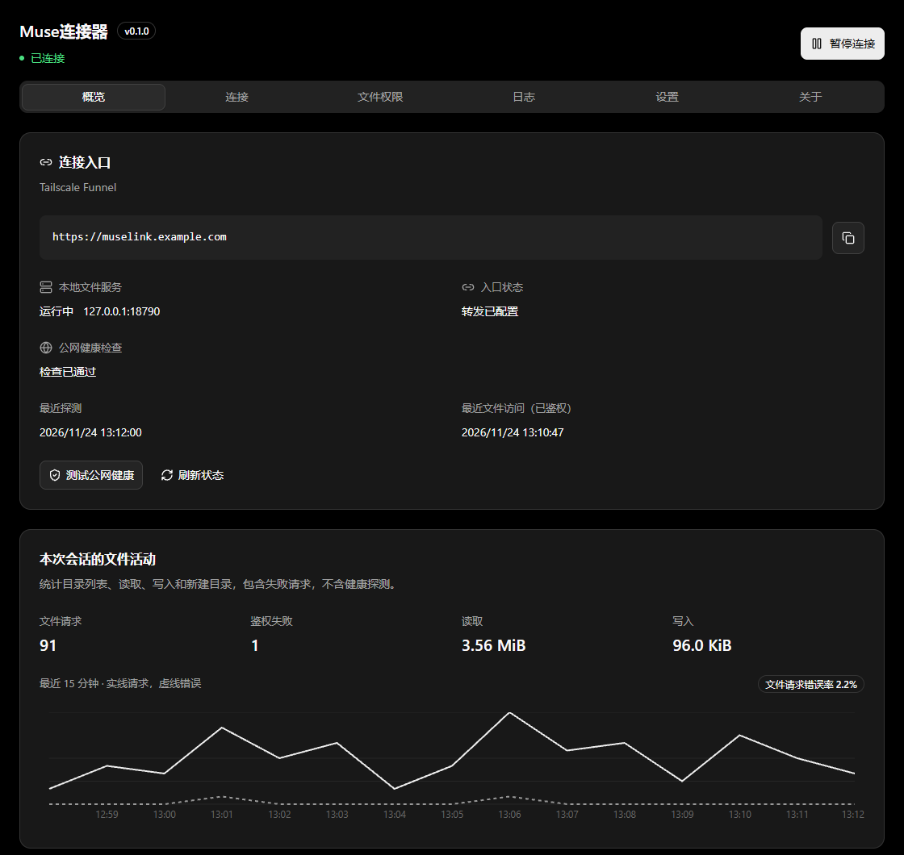
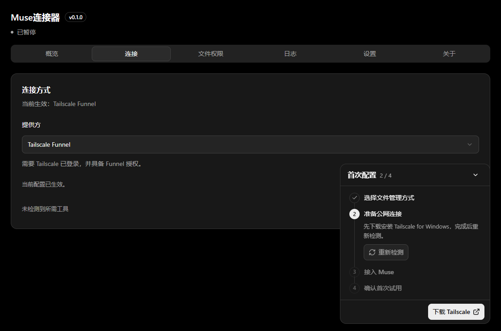
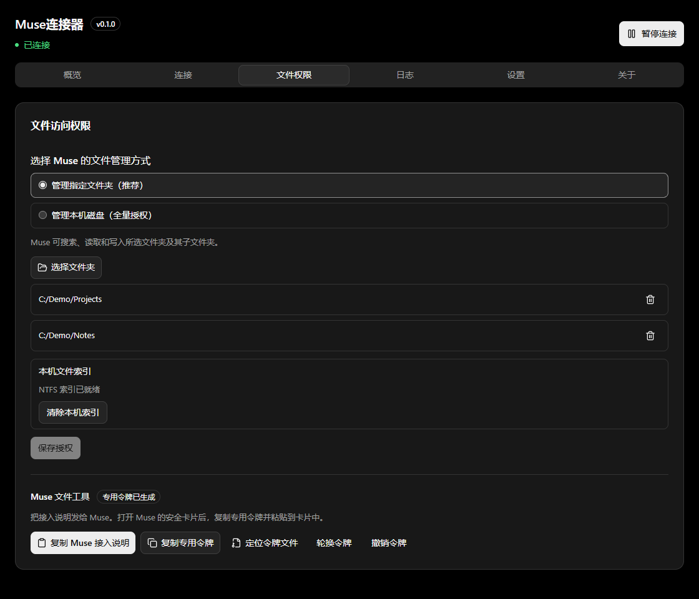

<p align="center">
  
</p>

<h1 align="center">MuseLink · Muse连接器</h1>

<p align="center">
  让 Muse 在你授权的文件夹和磁盘中搜索、读取与写入 Windows 本机文件。
</p>

<p align="center">
  <a href="README.md">简体中文</a> · <a href="README.en.md">English</a> ·
  <a href="#使用指南">使用指南</a> · <a href="#从源码构建">源码构建</a>
</p>

<p align="center">
  
  
</p>



## 界面预览

右下角的配置指引会带你完成文件授权、准备公网连接、接入 Muse 和首次试用。之后可以回到「文件权限」调整目录或磁盘，管理索引和 Muse 专用令牌。

<table>
  <tr>
    <td width="50%" align="center">
      <a href="assets/readme/zh-cn/setup-guide.png"></a><br>
      <sub>首次配置 · 准备公网连接</sub>
    </td>
    <td width="50%" align="center">
      <a href="assets/readme/zh-cn/file-access.png"></a><br>
      <sub>文件权限 · 管理授权与令牌</sub>
    </td>
  </tr>
</table>

截图来自 MuseLink 界面，目录、地址和访问统计均为演示数据。

## 功能概览

| 能力 | 可以做什么 |
| --- | --- |
| 文件授权 | 选择指定文件夹及其子目录，或从本机固定磁盘中选择授权范围。 |
| 本机文件工具 | 让 Muse 按文件名查找文件、列出目录、读取内容，并按需写入。 |
| 公网连接 | 默认使用 Tailscale Funnel，也支持 Cloudflare 临时隧道和命名隧道。 |
| 专用凭证 | 在「文件权限」生成、复制、轮换或撤销 Muse 专用令牌。 |
| 桌面管理 | 查看连接状态和文件访问日志，从应用或托盘启停连接，切换简体中文或 English。 |

## 使用指南

MuseLink 目前提供源码构建。按[构建步骤](#从源码构建)生成 Windows 安装包后启动应用。默认方式需要安装 [Tailscale for Windows](https://tailscale.com/download/windows) 并登录。

1. 在「概览」点击「开始引导」。
2. 选择要授权的文件夹或磁盘。磁盘模式默认选中所有可用的本机固定磁盘，展开下拉框即可调整。
3. 生成 Muse 专用令牌，按指引授权 Funnel、开启连接并验证公网入口。
4. 把接入说明发给 Muse，把专用令牌粘贴到 Muse 发来的安全卡片。
5. 在授权范围内挑一份无敏感内容的文件试读，核对 Muse 返回的内容。

第一次保存授权后，文件索引会在后台建立。在「文件权限」可以查看索引状态或重新建立索引。「设置 → 界面语言」会记住你的语言选择。

## 权限与连接边界

- Muse 的操作受已保存的授权范围和当前 Windows 账户权限约束。公网地址通过所选隧道转发到本机文件服务。
- 把专用令牌填进 Muse 的安全卡片。需要停止访问时，可以暂停连接或撤销令牌。轮换后需要在安全卡片里更新令牌。
- 公网健康检查确认入口可用。使用一份无敏感内容的文件在 Muse 实际试读，才能确认 Muse 已接入。
- Cloudflare 命名隧道需要账户下的可用域名。如果切换提供方后公网地址有变化，需要更新 Muse 中的连接地址。

## 从源码构建

准备 Windows、WebView2、Node.js 22.12 或更新版本、pnpm、Rust MSVC 工具链与 Visual Studio C++ Build Tools。在仓库根目录运行下面的命令启动开发环境。

```powershell
pnpm -C muse-connector install --frozen-lockfile
pnpm -C muse-connector tauri dev
```

开发模式使用独立的本机配置与模拟连接。以下命令用于构建前端、运行测试和生成 NSIS 安装包。

```powershell
pnpm -C muse-connector build
cargo test --manifest-path muse-connector/src-tauri/Cargo.toml --locked
pnpm -C muse-connector tauri build --bundles nsis
```

安装包输出在 `muse-connector/src-tauri/target/release/bundle/nsis/`。如只需 EXE，运行 `pnpm -C muse-connector tauri build --no-bundle`，输出为 `muse-connector/src-tauri/target/release/muse-connector.exe`。

## 致谢

旧版文件接口基于 [muse-file-bridge](https://github.com/TTNAN/muse-file-bridge) v0.3 协议。上游 MIT 许可证声明见 [THIRD_PARTY_NOTICES.md](./THIRD_PARTY_NOTICES.md)。
