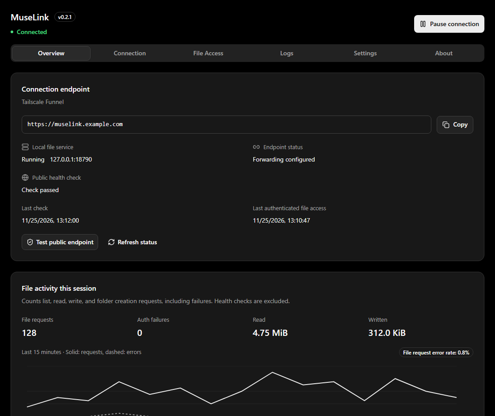
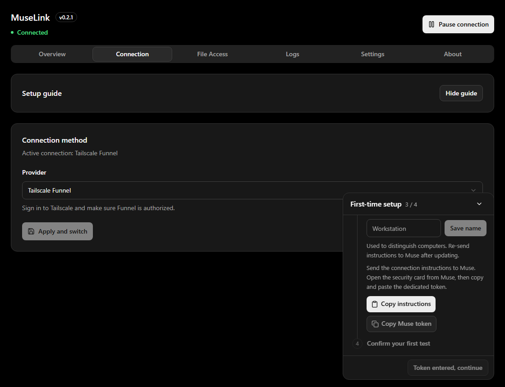
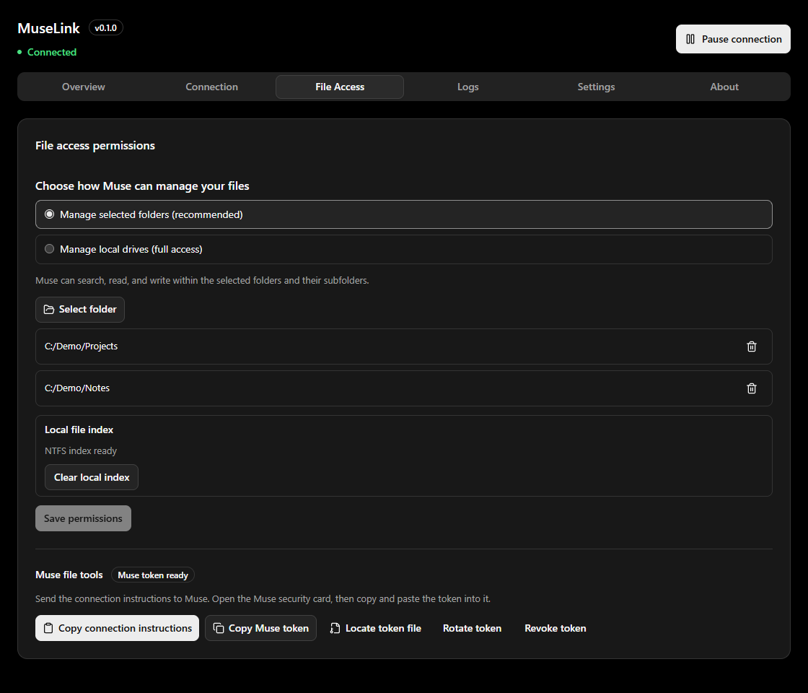
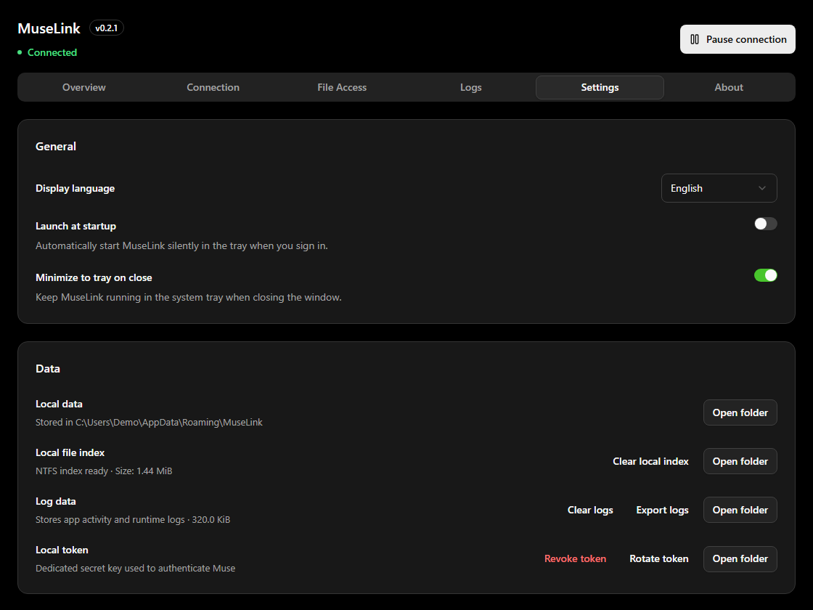

<p align="center">
  
</p>

<h1 align="center">MuseLink — Muse için Yerel Dosya Bağlayıcısı</h1>

<p align="center">
  Muse'un Windows, Linux ve macOS üzerinde yetkilendirilmiş yerel dosyaları aramasına, okumasına ve yazmasına izin verin; isteğe bağlı olarak Windows üzerinde yerel onayla yazma kısıtlamalı bir korumalı alan (sandbox) içinde proje komutlarını çalıştırın.
</p>

<p align="center">
  <a href="README.md">简体中文</a> · <a href="README.en.md">English</a> · <a href="README.ja.md">日本語</a> · <a href="README.tr.md">Türkçe</a> ·
  <a href="https://github.com/Aenvo/MuseLink/releases/latest">En son sürümü indir</a> ·
  <a href="#hızlı-başlangıç">Hızlı başlangıç</a> · <a href="#kaynaktan-derleme">Kaynaktan derleme</a> ·
  <a href="CHANGELOG.en.md">Değişiklik günlüğü</a>
</p>

<p align="center">
  
  
  
  
  <a href="./LICENSE"></a>
</p>



## Uygulama önizlemesi

Sağ alt köşedeki kurulum rehberi dosya erişimi verme, genel bir bağlantı hazırlama, Muse'u bağlama ve ilk kez test etme adımlarında size yol gösterir. Yetkili klasörleri veya sürücüleri ayarlamak ve yerel komut yürütmeyi açıp kapatmak için **File Access** sekmesine dönün, **Connection** altından bağlantı yönergelerini ve özel belirteci (token) kopyalayın ya da **Settings → Data** altından yerel dosya dizinini, günlükleri ve belirteci yönetin.

<table>
  <tr>
    <td width="33%" align="center">
      <a href="assets/readme/en/setup-guide.png"></a><br>
      <sub>İlk kurulum · Muse'u Bağla</sub>
    </td>
    <td width="33%" align="center">
      <a href="assets/readme/en/file-access.png"></a><br>
      <sub>File Access · İzinler ve komut korumalı alanı</sub>
    </td>
    <td width="33%" align="center">
      <a href="assets/readme/en/settings.png"></a><br>
      <sub>Settings · Genel ve Veri</sub>
    </td>
  </tr>
</table>

Bu ekran görüntüleri örnek klasörler, bir demo adresi ve örnek dosya etkinliği ile MuseLink arayüzünü göstermektedir.

## Özellikler

| Özellik | Ne yapar |
| --- | --- |
| Dosya izinleri | Seçilen klasörleri ve alt klasörlerini yetkilendirin veya yerel sabit sürücüler arasından seçim yapın; kimlik bilgileri ve hassas sistem yolları için yerleşik koruma içerir. |
| Yerel dosya araçları | Muse'un dosya adına göre arama yapmasına, klasörleri listelemesine, dosyaları okumasına ve gerektiğinde yazmasına veya klasör oluşturmasına izin verin. |
| Kontrollü komut yürütme | Varsayılan olarak kapalıdır; etkinleştirildiğinde Muse'un çalışma alanı başına Windows yazma kısıtlamalı korumalı alan ve 3 aşamalı yerel onay iletişim kutusu altında yetkili proje alt klasörlerinde geliştirici araçlarını ve kontrollü PowerShell/cmd komutlarını çalıştırmasına olanak tanır. |
| Genel bağlantı | Varsayılan olarak Tailscale Funnel kullanın veya kendi alan adınızla bir Cloudflare adlandırılmış tüneli seçin. |
| Özel belirteç | **Connection** altında Muse bağlantı yönergelerini ve özel belirteci oluşturup kopyalayın; **Settings → Data** altında belirteci yenileyin, iptal edin veya konumunu bulun; günlüklerde otomatik belirteç gizleme desteği sunar. |
| Masaüstü kontrolleri | Günlükleri zaman aralığına, sonuca, kapsama ve anahtar sözcüğe göre filtreleyin ve arayın; **Settings → Data** altında disk kullanımını inceleyin, günlükleri temizleyin veya dışa aktarın (`JSONL`/`CSV`) ve yerel dosya dizinini yönetin; uygulama içi güncelleme denetimleri, kapatılabilir güncelleme bildirimleri, senkronize uygulama içi değişiklik günlüğü/sürüm notları pencereleri, başlangıçta sessiz başlatma, kapatıldığında sistem tepsisine küçültme seçeneği, çıkışta temiz alt süreç sonlandırma ve Basitleştirilmiş Çince / İngilizce / Japonca arayüz desteği sunar. |

## İndirme ve kurulum

[GitHub Releases](https://github.com/Aenvo/MuseLink/releases/latest) sayfasından bir Windows x64, Linux x64 veya macOS Universal (Apple Silicon ve Intel) derlemesi seçin (Windows derlemeleri WebView2 gerektirir).

| Derleme | İndirme ve başlatma |
| --- | --- |
| Windows Portable | `MuseLink-<version>-windows-x64-portable.zip` dosyasını indirin, arşivin tamamını çıkarın ve `muse-connector.exe` dosyasını çalıştırın (doğrudan indirme bağlantısıyla güncelleme uyarılarını destekler). |
| Windows Installer | `MuseLink-<version>-windows-x64-setup.exe` dosyasını indirin ve yükleyiciyi çalıştırın (**About → Check for updates** altında otomatik yeniden başlatmalı Minisign doğrulamalı uygulama içi güncellemeleri destekler). |
| Linux AppImage | `MuseLink-<version>-linux-x64.AppImage` dosyasını indirin, çalıştırılabilir yapın ve doğrudan çalıştırın (otomatik yeniden başlatmalı Minisign doğrulamalı uygulama içi güncellemeleri destekler). |
| Linux deb | `MuseLink-<version>-linux-x64.deb` dosyasını indirin ve paket yöneticinizle kurun (güncelleme uyarılarını, sürüm notlarını ve doğrudan indirme bağlantılarını destekler). |
| macOS Installer (Universal) | `MuseLink-<version>-macos-universal.dmg` dosyasını indirin, açın ve `MuseLink.app` uygulamasını `Applications` klasörüne sürükleyin (Apple Silicon ve Intel; güncelleme uyarılarını ve doğrudan indirme bağlantılarını destekler). |
| macOS Portable (Universal) | `MuseLink-<version>-macos-universal.app.zip` dosyasını indirin ve `MuseLink.app` uygulamasını doğrudan çıkarın. |

İndirmenizi doğrulamak için aynı sürümdeki `SHA256SUMS.txt` dosyasını kullanın. MuseLink yürütülebilir dosyaları ve yükleyicileri imzasızdır, bu nedenle Windows bilinmeyen yayıncı uyarısı gösterebilir.

> **macOS ilk başlatma için önemli not:** macOS derlemeleri şu anda geçici (ad-hoc) olarak imzalandığından ve bir Apple Developer ID ile noter onayından geçmediğinden Gatekeeper tarayıcıdan indirilen derlemeleri ilk açılışta engeller:
> 1. `MuseLink.app` uygulamasını bir kez açmayı deneyin, ardından **Sistem Ayarları → Gizlilik ve Güvenlik** bölümüne gidin, aşağı kaydırarak **Güvenlik** kısmına inin ve **Yine de Aç**'a tıklayın.
> 2. macOS Sequoia (15+) uygulamanın "hasarlı ve açılamıyor" olduğunu bildirmeye devam ederse, Terminal'de indirme karantina özniteliğini bir kez temizleyin:
>    ```bash
>    xattr -dr com.apple.quarantine /Applications/MuseLink.app
>    ```
> (Ayrıca kaynaktan yerel olarak da derleyebilirsiniz — aşağıdaki [Kaynaktan derleme → Linux](#linux) / [macOS](#macos) bölümlerine bakın.)

## Hızlı başlangıç

Varsayılan bağlantı yöntemi için [Tailscale](https://tailscale.com/download) kurun ve oturum açın.

1. **Overview** veya **Connection** sekmesinde **Start guide** seçeneğini seçin.
2. Yetkilendirilecek klasörleri veya sürücüleri seçin. Sürücü modunda tüm kullanılabilir yerel sabit sürücüler varsayılan olarak seçilidir. Seçimi daraltmak için menüyü açın.
3. Bir Muse belirteci (token) oluşturun. Funnel'ı yetkilendirmek, bağlantıyı başlatmak ve genel uç noktayı doğrulamak için rehberi izleyin.
4. Bu bilgisayar için bir cihaz adı kaydedin ve bağlantı yönergelerini Muse'a gönderin. Muse'un bağlayıcıyı oluşturmak veya güncellemek için bu adı kullandığını doğrulayın, ardından belirteci Muse'un geri gönderdiği güvenlik kartına yapıştırın.
5. Yetkili kapsam içinden hassas olmayan bir dosya seçin ve Muse'un döndürdüğü içeriği kontrol edin.

Birden fazla bilgisayar bağlarken her birine farklı bir cihaz adı, kendi bağlayıcısını ve kendi belirtecini verin. Muse'dan cihazı adıyla isteyin; örneğin "Laptop üzerindeki `hello.txt` dosyasını bul." Bağlı bir cihazı yeniden adlandırmak için yeni adı **Connection** altında kaydedin, ardından yeniden adlandırma yönergelerini kopyalayıp Muse'a yapıştırın. Muse onayını gönderdiğinde bekleyen durum temizlenir. Yeni adı Muse içinde de kontrol edebilir ve **Connection** altından elle onaylayabilirsiniz.

İzinleri ilk kez kaydettikten sonra arka planda dosya dizinleme başlar. Yerel verileri, dosya dizini kullanımını/yeniden oluşturmayı, günlük temizlemeyi/dışa aktarmayı ve belirteç yenileme/iptal işlemlerini **Settings → Data** altından yönetin. Görüntüleme dilini, başlangıçta sessiz başlatmayı ve kapatıldığında sistem tepsisine küçültmeyi **Settings → General** altından yapılandırın.

## Erişim ve bağlantı sınırları

- **Dosya ve hassas yol koruması**: Muse'un dosya işlemleri kaydedilen erişim kapsamını ve geçerli işletim sistemi hesabının izinlerini izler. Kimlik bilgisi dizinleri (`~/.muse-bridge`, `~/.ssh`, `~/.aws`, `~/.gnupg` ve macOS `~/Library/Keychains` gibi) varsayılan olarak hariç tutulur; sistem klasörleri, Startup/otomatik başlatma klasörleri, kabuk profilleri, `.gitconfig` ve uygulama dizini (macOS `.app` paketleri dâhil) varsayılan olarak yazmaya karşı korumalıdır. Okumalar ve atomik yazmalar açık işletim sistemi tanıtıcıları (handles) üzerinden doğrulanır.
- **Çalışma alanı başına yazma kısıtlamalı korumalı alan**: Yerel komut yürütme varsayılan olarak kapalıdır ve **File Access** altından etkinleştirilebilir (etkinleştirdikten sonra kurulum yönergelerini Muse'a yeniden kopyalayın). Komutlar, çalışma alanı başına SHA-256 türetilmiş benzersiz bir SID ile Windows yazma kısıtlamalı korumalı alanı (`CreateRestrictedToken(WRITE_RESTRICTED)` + `JobObject` bellek ve işlem sayısı kesin sınırları; yürütme zaman aşımı bir Job Object zaman sınırıyla değil, çalışma zamanı yoklamasıyla uygulanır) içinde çalışır. Yazmalar hedeflenen proje alt klasörü ve izole bir iş başına geçici dizinle sınırlandırılır (yalın sürücü kökleri reddedilir ve kardeş ya da üst klasörler birbirinin içine yazamaz). Ancak kısıtlayıcı belirtecin `Everyone` (S-1-1-0) ve `RESTRICTED` (S-1-5-12) SID'lerini de içerdiğini unutmayın; bu nedenle bu SID'lere yazma erişimi veren herhangi bir konum (herkese yazılabilir paylaşılan klasörler veya özel ACL dizinleri gibi) yazılabilir kalır. Korumalı alan yalnızca yazmaları kısıtlar; okumalar izole edilmez ve komutu çalıştıran kullanıcının izinleriyle çalışır. Dahili ortam değişkenleri temizlenir ve korumalı alan başlatma işlemi korumalı alansız yürütmeye sessizce geri dönmeden hata durumunda kapalı (fail-closed) kalır.
- **3 aşamalı risk modeli ve otomatik yükseltilen onay iletişim kutusu**:
  - **Otomatik izin verilenler**: Standart salt okunur ve proje derleme/test komutları (`git status`/`diff`/`log`, `cargo test`/`check`, `pnpm build`, `pytest` gibi) sizi kesintiye uğratmadan çalışır ve hızlı tamamlandığında doğrudan HTTP 200 döndürür; saf salt okunur doğrudan komutlar çalışma alanı yazma ACL'lerini tamamen atlar.
  - **Proje başına oturum onayı**: Bir projede ilk kez `powershell`/`cmd` kullanımı, paket kurulumları/güncellemeleri veya `git push`, `GET /agent/v1/exec/<job_id>?wait_ms=20000` üzerinden uzun yoklama (long-polling) ile MuseLink penceresini ön plana getirir (120 saniyelik zaman aşımı varsayılan olarak reddeder); böylece Muse manuel sohbet yanıtı beklemeden onayları ve çıktıları hemen alır. **Allow once** veya **Allow project this session** (4 saat geçerli, klasör başına sıkı şekilde kapsamlandırılmış, **File Access** içindeki **Revoke session grants** üzerinden her zaman iptal edilebilir) seçeneklerinden birini seçin.
  - **Her zaman tek seferlik onay**: Hassas yollar, üst dizine geçiş (`..`), force push, özyinelemeli/zorla silme, sistem yönetimi araçları, gizlenmiş (obfuscated) betikler veya `unsandboxed` istekleri her zaman oturum izinleri devre dışı bırakılmış olarak tek kullanımlık onay gerektirir.
- **Acil durdurma, gizleme ve temiz sonlandırma**: Komut yürütmeyi devre dışı bırakmak, bağlantıyı duraklatmak veya belirteci yenilemek/iptal etmek çalışan komutları ve bekleyen onayları hemen iptal eder ve alt süreç ağaçlarını sonlandırır. Denetim ve çalışma zamanı günlükleri `mfa_` belirteçlerini otomatik olarak gizler ve **Files** veya **Command execution** ile filtrelenebilir. MuseLink'ten çıkmak yönetilen `Everything.exe`, `cloudflared` ve komut alt süreçlerini Windows JobObjects aracılığıyla temiz bir şekilde sonlandırır.
- **İzin değişiklikleri ve eski uyumluluk**: Dosyaları ilk kez yetkilendirdiğinizde Muse bu kapsam içinde arama yapabilir, okuyabilir ve yazabilir. Seçili klasörlere geçmek yalnızca önceki izninizin kapsadığı işlemleri korur; klasörlerden sürücülere geçmek seçili sürücülerdeki tüm işlemlerin onaylanmasını gerektirir. Eski salt okunur File Bridge ayarları eski API için geçerli olmaya devam eder.
- **Belirteçler ve tüneller**: Özel belirteci Muse güvenlik kartına girin. Erişimi durdurmak için bağlantıyı duraklatın veya belirteci iptal edin ve yeniledikten sonra güvenlik kartını güncelleyin. Cloudflare adlandırılmış tünelleri hesabınızda kullanılabilir bir alan adı gerektirir; sağlayıcı değiştirmek genel uç noktayı değiştirdiğinde Muse içindeki URL'yi güncelleyin.
- **Dosya boyutu sınırları ve büyük dosya okumaları**: `/agent/v1/read`, **10 MiB**'a kadar tam dosya JSON okumalarının yanı sıra **toplam dosya boyutu sınırı olmaksızın** `offset`/`limit` parçalı okuma (JSON parçası başına varsayılan 2 MiB / en fazla 4 MiB, `if_match` / `ETag` tutarlılık kontrolleriyle) ve `raw=1` ham ikili akış (Base64 ek yükü olmadan, istek başına en fazla 32 MiB; tünel kararlılığı için 4 MiB üzerinde 4 MiB'lık parçalar önerilir) destekler. Tek dosya yazmaları **10 MiB** ile sınırlıdır ve eski `/api/read` v0.3 uyumluluğu için **2 MiB** olarak kalır.

## Kaynaktan derleme

### Windows

Windows, WebView2, Node.js 22.12 veya üzeri, pnpm, Rust MSVC araç zinciri ve Visual Studio C++ Build Tools gerekir. Geliştirmeye başlamak için depo kökünden şu komutları çalıştırın.

```powershell
pnpm -C muse-connector install --frozen-lockfile
pnpm -C muse-connector tauri dev
```

Geliştirme modu ayrı yerel ayarlar ve simüle edilmiş bir bağlantı kullanır. Aşağıdaki komutlar ön ucu derler, testleri çalıştırır ve bir NSIS yükleyicisi oluşturur.

```powershell
pnpm -C muse-connector build
cargo test --manifest-path muse-connector/src-tauri/Cargo.toml --locked
pnpm -C muse-connector tauri build --bundles nsis
```

Yükleyici `muse-connector/src-tauri/target/release/bundle/nsis/` dizinine yazılır. `TAURI_SIGNING_PRIVATE_KEY` olmadan imzasız bir yerel yükleyici oluşturmak için `--config '{\"bundle\":{\"createUpdaterArtifacts\":false}}'` ekleyin veya yalnızca `muse-connector/src-tauri/target/release/muse-connector.exe` dosyasını üretmek için `pnpm -C muse-connector tauri build --no-bundle` komutunu çalıştırın.

### Linux

Bir Rust araç zinciri, Node.js 22.12 veya üzeri, pnpm ve şu sistem paketleri gerekir: `build-essential`, `pkg-config`, `libwebkit2gtk-4.1-dev`, `libgtk-3-dev`, `libayatana-appindicator3-dev`, `librsvg2-dev`, `libsoup-3.0-dev`, `libxdo-dev` ve `libssl-dev`. Debian/Ubuntu üzerinde:

```bash
sudo apt install build-essential pkg-config libwebkit2gtk-4.1-dev libgtk-3-dev \
  libayatana-appindicator3-dev librsvg2-dev libsoup-3.0-dev libxdo-dev libssl-dev
```

Depo kökünden:

```bash
pnpm -C muse-connector install --frozen-lockfile
pnpm -C muse-connector build
cargo test --manifest-path muse-connector/src-tauri/Cargo.toml --locked
pnpm -C muse-connector tauri build --no-bundle
```

Sürüm ikilisi `muse-connector/src-tauri/target/release/muse-connector` konumuna yazılır. Yerel UI geliştirme için `pnpm -C muse-connector tauri dev` kullanın (Windows'takiyle aynı izole yapılandırma).

**Kurulum:** Linux için Tailscale yükleyin ve bir kez `sudo tailscale set --operator=$USER` komutunu çalıştırın; aksi hâlde uygulama Funnel'ı yapılandıramaz (serve config reddedilir).

**Sınırlama:** Korumalı alanlı komut yürütme (`exec`) yalnızca Windows içindir; Linux'ta devre dışı kalır ve hata durumunda kapalı (fail-closed) çalışır.

### macOS

Bir Rust araç zinciri, Node.js 22.12 veya üzeri, pnpm ve Xcode Command Line Tools (`xcode-select --install`) gerekir. Depo kökünden:

```bash
pnpm -C muse-connector install --frozen-lockfile
pnpm -C muse-connector build
cargo test --manifest-path muse-connector/src-tauri/Cargo.toml --locked
pnpm -C muse-connector tauri build --bundles app --config '{"bundle":{"createUpdaterArtifacts":false}}'
```

Uygulama paketi `muse-connector/src-tauri/target/release/bundle/macos/` dizinine yazılır. Yalnızca `muse-connector/src-tauri/target/release/muse-connector` ikilisini üretmek için `pnpm -C muse-connector tauri build --no-bundle` komutunu çalıştırın. Yerel UI geliştirme için `pnpm -C muse-connector tauri dev` kullanın (Windows'takiyle aynı izole yapılandırma).

**Kurulum:** Tailscale uygulamasını web sitesinden veya Mac App Store'dan yükleyin ve oturum açın; uygulama, paket içindeki CLI'yi (`/Applications/Tailscale.app/Contents/MacOS/Tailscale`) otomatik olarak bulur ve `tailscale` / `cloudflared` Homebrew kurulumları (`/opt/homebrew/bin`) da keşfedilir. Masaüstü, Belgeler veya İndirilenler gibi korunan klasörlere erişmek için **Manage local drives (full access)** kullanırken macOS sistem istemine izin verin veya **Sistem Ayarları → Gizlilik ve Güvenlik** altından `MuseLink` uygulamasına erişim (veya **Tam Disk Erişimi**) verin.

**Sınırlama:** Korumalı alanlı komut yürütme (`exec`) yalnızca Windows içindir; macOS'ta devre dışı kalır ve hata durumunda kapalı (fail-closed) çalışır. macOS derlemeleri şu anda imzasızdır ve noter onaylı değildir; yerel olarak kaynaktan derleyip kullanım içindir; tarayıcıdan indirilen bir paket Gatekeeper tarafından engellenebilir.

## Topluluk

Bu proje, paylaşıldığı ve tartışıldığı [LINUX DO](https://linux.do/) topluluğuna bağlantı verir ve onu tanır. Hata bildirimleri, uyumluluk geri bildirimleri ve özellik önerileri GitHub Issues üzerinden memnuniyetle karşılanır.

## Lisans ve teşekkürler

MuseLink, [MIT Lisansı](./LICENSE) altında açık kaynaklıdır. Eski dosya API'si [muse-file-bridge](https://github.com/TTNAN/muse-file-bridge) v0.3 protokolünü temel alır. Üçüncü taraf lisansları ve paketlenmiş ikili bildirimleri için [THIRD_PARTY_NOTICES.md](./THIRD_PARTY_NOTICES.md) dosyasına bakın.
